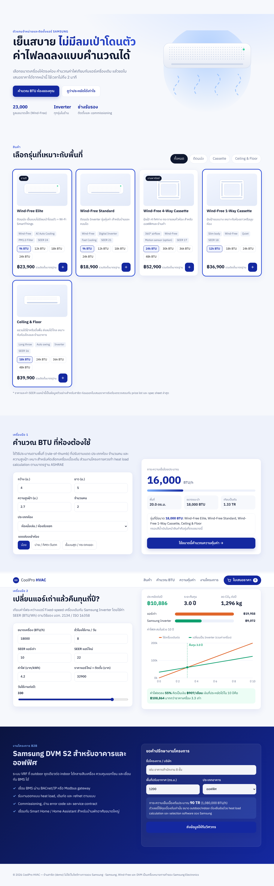

# CoolPro HVAC — Samsung AC demo shop

Static, single-page demo shop (no build step). Open `index.html` in a browser.

## Features
- **Product catalog**: Wind-Free wall, 4-way/1-way cassette, Ceiling & Floor. Filter by type, pick a capacity, add to quote.
- **BTU calculator**: area × room factor (700–950 BTU/h·m²), +10/20 % for sun load, ceiling-height scaling, +600 BTU/h per extra occupant. Rounds up to a standard size and highlights matching models.
- **Energy / payback calculator**: kWh/yr = BTU/h × h/yr ÷ SEER ÷ 1000 (SEER per TIS 2134 / ISO 16358). Shows annual savings, payback, CO₂ (0.5 kgCO₂/kWh), and a 10-year cumulative cost chart with the break-even point.
- **Quote drawer**: quantity editing, 5 % discount for 3+ units, VAT 7 %, copy-to-clipboard text for LINE or email. The cart is saved in localStorage.
- **DVM S2 project lead form**: preliminary TR estimate by building type.

## Caveats
- Prices and SEER values are **illustrative demo data**. Check them against the current Samsung price list and spec sheets before quoting.
- The BTU method is a rule of thumb for pre-selection. Projects need a proper heat-load calculation (ASHRAE) and Samsung selection software.
- The lead form does not send data anywhere.

